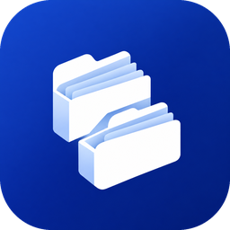
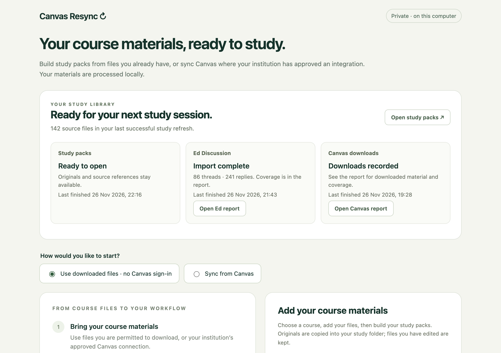

<div align="center">

<br/>



<h1>Canvas Study Sync</h1>

<p>
  <strong>Turn your course files and Ed discussions into searchable, source-linked study packs.</strong><br/>
  Keep a local course archive, prepare subject packs for NotebookLM or your editor, and trace every extract back to its original page or cell.<br/>
  macOS · Windows · Python 3.11+ · 100% Local Processing
</p>

<p>
  <a href="LICENSE"></a>
  <br/>
  
  <br/>
  
  <a href="https://github.com/shadjosef/canvas-study-sync/actions/workflows/tests.yml"></a>
  <a href="https://github.com/shadjosef/canvas-study-sync/actions/workflows/codeql.yml"></a>
</p>

<p>
  <a href="https://github.com/shadjosef/canvas-study-sync/archive/refs/heads/main.zip"></a>
</p>

<p>
  <a href="docs/QUICKSTART.md"><strong>Quickstart Guide</strong></a> ·
  <a href="AI_SETUP.md">Set up with an AI assistant</a> ·
  <a href="docs/ED_DISCUSSION.md">Ed Discussion Setup</a> ·
  <a href="SECURITY.md">Security</a> ·
  <a href="https://github.com/shadjosef/study-os">Study-OS Workbench</a>
</p>

<br/>



<p><sub>Local loopback workspace — study packs, Ed Discussion imports, and Canvas downloads tracked independently on your own computer.</sub></p>

</div>

> [!NOTE]
> **Local-first by design.** Files are processed on your machine and saved in your chosen study folder (`Documents/Canvas-Archive`); the app does not call an AI service, generate answers, train a model, or automatically upload your course material.

<p align="center">
  <a href="#choose-your-workflow">Workflow</a> ·
  <a href="#what-you-get">What you get</a> ·
  <a href="#first-run">First run</a> ·
  <a href="#where-to-find-the-result">Outputs</a> ·
  <a href="#privacy-and-access">Privacy &amp; access</a> ·
  <a href="#development-and-feedback">Development</a> ·
  <a href="#license">License</a>
</p>

---

## Choose your workflow

| What you have | What to do |
| --- | --- |
| **Downloaded slides, PDFs, notes or notebooks** | Choose **Use downloaded files**, add your materials, and click **Build study packs**. No Canvas login needed. |
| **An Ed Discussion course** | Open **Import Ed Discussion** under downloaded files. Add your own Ed API token and optionally remember it in your OS keychain. [Ed setup →](docs/ED_DISCUSSION.md) |
| **An institution-configured Canvas integration** | Choose **Sync from Canvas** for incremental downloads through approved OAuth. [Connection setup →](docs/OAUTH_SETUP.md) |

Automatic Canvas syncing requires institution-approved configuration. There is no bundled developer key or universal sign-in service. Local files and Ed imports work independently of Canvas OAuth.

---

## What you get

- **Study packs by subject:** Extracted text from PDFs, slide decks, Word documents, spreadsheets, Jupyter notebooks, code, and datasets, with source/page/cell provenance and a local search index.
- **Ed posts and replies:** Accessible threads, answers, nested comments, maths, code, and supported attachments. Staff and anonymous posts are labelled; coverage reports highlight gaps and unmatched courses.
- **A clean local archive:** Original material stays right alongside generated packs. With configured Canvas access, new or changed attachments download incrementally while unchanged files are reused.
- **Honest refresh reports:** Canvas, Ed, and local study-context freshness are recorded separately. Failed refreshes retain your previous committed assistant snapshot.
- **Optional timetable context:** Integrates a TimeEdit feed or local timetable snapshot.
- **Portable study copies:** Move your archive between your own computers. Saved Ed credentials stay in the OS secure store and never enter portable ZIPs.

*(Source extraction can miss scanned text, diagrams, and visual equations; coverage reports point directly back to the originals.)*

---

## First run

1. Install **Python 3.11 or newer**. [Download](https://github.com/shadjosef/canvas-study-sync/archive/refs/heads/main.zip) and extract the source ZIP outside your private course archive.
2. Open **`OPEN_RESYNC.command`** on macOS or **`OPEN_RESYNC.cmd`** on Windows. If Finder does not launch it, run `zsh ./OPEN_RESYNC.command` in the extracted folder.
3. Choose **Use downloaded files**. Enter a course name or Ed code, click **Create course**, select its files, and click **Add selected files**. No manual folder naming is needed.
4. Click **Build study packs**, then **Open study packs**. The home screen shows separate freshness status for study packs, Ed, and Canvas.

The default study folder is **`Documents/Canvas-Archive`**, separate from this source repository. Existing archives and manually managed numeric course folders still work. For automatic Ed matching, use the exact Ed course code as the course name.

PDF, timezone, and secure-storage dependencies are prepared automatically on the first run that needs them. Keep your computer awake while running; closing the browser tab does not stop an active run—reopen the launcher to return to live progress.

<details>
<summary><strong>Remembering Ed sign-in &amp; recovery details</strong></summary>

- **OS keychain storage:** Select your Ed region, paste the token into the local app's hidden field, and check **Remember on this computer**. Tokens are stored only after an authenticated import via **macOS Keychain**, **Windows Credential Manager**, or **Linux Secret Service** (zero plaintext fallback). Leave the field blank on subsequent runs, or click **Forget saved Ed token** to remove it. See [Ed setup and troubleshooting](docs/ED_DISCUSSION.md).
- **Isolated recovery:** Study packs, Ed imports, and Canvas downloads keep independent dates. If a local file blocks rebuilding, the blocked file and next action stay visible after reopening (**Open source folder** / **Retry study packs**) while retaining your previous committed snapshot. Identical re-added files are deduplicated; modified files get a separate copy so annotated originals stay intact.

</details>

---

## Where to find the result

| Output | Use |
| --- | --- |
| `00_START_HERE.md` | Guide to the private archive and current outputs |
| `AI_READY/NOTEBOOKLM` | Subject packs and instructions for choosing sources |
| `AI_READY/VSCODE` | Subject workspaces for a local editor |
| `ASSISTANT_CONTEXT/CURRENT.json` | Latest committed context and source freshness |
| `ED_SYNC_REPORT.html` | Latest Ed attempt, coverage, and course matches |
| `SYNC_REPORT.html` | Canvas downloads and access notices, after a Canvas sync |

Originals remain available for checking diagrams, tables, and extraction gaps. Keep your own edits in **`Practice`** or a separate copy; generated packs are refreshed on rebuild. Updating local packs does not update sources you already uploaded to NotebookLM.

---

## Is this the right tool?

Choose **Canvas Study Sync** if you want **local study packs with traceable sources and Ed discussions** (source-based beta, not a packaged desktop installer).

- For a full exam-prep & active-recall workbench with verified exercises, FSRS-5 scheduling, and a Chrome extension, see **[Study-OS (`studyos.no`)](https://github.com/shadjosef/study-os)**.
- For a browser-based Canvas archive using your existing login, consider [jasp-nerd's Canvas Course Downloader](https://github.com/jasp-nerd/canvas-course-downloader).
- For a packaged desktop downloader with broader sync, conversion, and Panopto features, compare [BrkBuilds' Canvas Downloader](https://github.com/BrkBuilds/Canvas-Downloader).
- For building custom Canvas scripts, see [CanvasAPI](https://github.com/ucfopen/canvasapi).

---

## Privacy and access

Keep course material, reports, timetable links, and archive state private. A portable study ZIP contains your materials and is intended strictly for your own devices—not as a public release. Passwords and tokens belong in the local window, never in an AI chat or GitHub issue.

The local window binds to loopback (`127.0.0.1`) with a random per-session access key, strict `Host`/`Origin` checks, and zero external page assets. API credentials are restricted to their configured HTTPS service, dependency installers receive no credentials, and Ed uses `GET` requests with OS-keychain regional tokens. See [`SECURITY.md`](SECURITY.md) for the full threat model.

Use only materials and access methods your institution permits. Independent community software, not affiliated with or endorsed by Instructure, Canvas, Ed, TimeEdit, or any educational institution. See [`docs/USAGE.md`](docs/USAGE.md) and [`USE_POLICY.md`](USE_POLICY.md).

---

## Development and feedback

```bash
python3 -m pip install -r canvas-sync/requirements-ai.txt
python3 -B -m unittest discover -s canvas-sync/tests
python3 -B tools/check_release.py
```

*(Use `python` on Windows. All 225 tests use synthetic data and mocked service responses. CI covers Python 3.11 and 3.14 on macOS, Windows, and Linux alongside weekly CodeQL security scanning.)*

Useful contributions include clearer setup instructions, extraction improvements, and reproducible import bugs. [Report an issue](https://github.com/shadjosef/canvas-study-sync/issues/new/choose) with your OS and a redacted error (never attach tokens or private course exports). See [`CONTRIBUTING.md`](CONTRIBUTING.md).

---

## License

[PolyForm Noncommercial 1.0.0](LICENSE): **source available, not OSI open source**. Read the license for permitted uses and grants. The code license grants no rights to course materials, student data, third-party services, or trademarks. [`USE_POLICY.md`](USE_POLICY.md) describes supported scope without rewriting the license.
